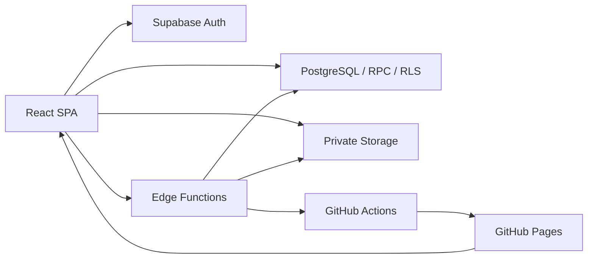

# 共通設計

[索引](design-index.md) / [DB](data-model.md) / [API](api.md) / [画像](images.md)

## 構成と責務

React 19・TypeScript・Vite 7のSPA。React Router 7のBrowserRouterを使用し、認証・DB・非公開Storage・管理APIはSupabaseが担当します。GitHub Pagesは静的成果物を配信し、アプリ独自の常駐Webサーバーはありません。

| 配置 | 責務 |
| --- | --- |
| `src/main.tsx` | StrictMode、BrowserRouter、AuthProvider、AppRoutesを組み立て |
| `src/pages/` | 6画面の状態管理と通信 |
| `src/components/` | Header、Modal、画面内のフォーム・一覧・画像編集 |
| `src/contexts/AuthContext.tsx` | セッションとプロフィール |
| `src/lib/` | 入力検証、保存、ランキング、画像圧縮・設定 |
| `src/hooks/useReviewImages.ts` | 管理画面の画像取得・メモリキャッシュ |
| `src/types.ts` | Role、CharacterOption、EventEdition、Submission、Review等 |
| `supabase/migrations/` | 順番に適用するDBスキーマ・関数・権限 |
| `supabase/functions/` | 管理操作とPages連携 |

`Category` は固定2値のenumではなくstring。対象キャラクター2名は開催回に保持します。応募部門はopen / switch_off / beginner、レビュー状態はpending / verified / invalidです。

## 認証とルーティング

Supabaseクライアントは `VITE_SUPABASE_URL` と `VITE_SUPABASE_ANON_KEY` を使用。セッション永続化、自動トークン更新、URLからのセッション検出を有効化します。環境変数不足時はダミー値でクライアントを作り、ログイン画面で警告し送信を無効化します。

AuthProviderはgetSession後に自身のprofiles行を読み、loadingを解除します。onAuthStateChangeでもセッションを更新し、プロフィール取得をsetTimeoutで遅延実行します。プロフィール取得エラー専用の表示・再試行UIはありません。

- 全ページをlazy importし、Suspense中はスピナーを表示。
- Protected：認証読込中はスピナー、未認証は `/login` へreplace。元パスをstate.fromに保存しますが、LoginPageは復帰先として使用しません。
- 認証済み領域はHeaderとOutletを表示。
- AdminOnly：プロフィール読込中または未取得ならスピナー。userはdeniedフラグ付きで `/entry` へreplaceし、そこで権限エラーを表示。
- `/admin/rules` は管理者ガード内で `/admin/settings` へ転送。
- 未定義URLは `/entry` へ転送。ログイン成功時も常に `/entry`。

basenameはViteのBASE_URLから末尾スラッシュを除いて使用します。Pagesの直接アクセスは404.htmlが元URL（query/hashを含む）をsessionStorageのspa-redirectへ保存し、index.htmlがhistory.replaceStateで復元します。404側はURLの先頭パスをリポジトリ名とする計算です。

## 共通UI

Headerは回答入力・参加履歴を全認証ユーザーへ、ユーザー登録・回答結果・設定をadminへ表示します。参加履歴は `/history` で現在回を含む本人の回答を閲覧する専用画面です。ログアウトはsignOut完了後に `/login` へ移動。管理者用の折りたたみメニューはクリック、ナビゲーション選択、Escapeで開閉します。テーマ切替は全認証画面のHeaderとログイン画面右上に表示します。

Modalはrole=dialog、aria-modal、見出し参照と初期フォーカスを持ち、Escape・背景クリック・×でonCloseを呼びます。wideで横幅を変更します。フォーカストラップや閉じた際の元要素へのフォーカス復元は実装されていません。処理中に閉じられるかは各呼出元のonCloseに依存します。

styles.cssに日本語フォント、ライト／ダーク配色、共通カード・通知・入力・表・ランキングを集約し、900px以下と620px以下のメディアクエリーで配置を調整します。紫とシアンを両テーマのアクセントに使用します。ルール説明は改行を保持して表示します。設定画面の画像調整はcanvasを使用します。

初回表示はインラインスクリプトで `prefers-color-scheme` を読み、描画前にhtml要素の `data-theme` と `color-scheme` を設定します。`localStorage` の `gakumasu-theme` に有効な手動選択があればそちらを優先します。手動選択前は端末設定の変更へ追従し、切替ボタンを押すと選択したテーマを保存します。Storageを利用できない場合も表示中のページには反映します。

## データ境界と既存の制限

本人の回答・画像、管理者のレビュー、認証ユーザーが閲覧可能な開催回設定をRLSで区分します。画面ガードだけを認可に使用しません。受付判定とレビュー後の画像変更拒否はDBでも実施します。詳細はDB設計を参照。

参加履歴は専用RPCがauth.uid()で本人の回答だけに制限し、レビューから確認状態と確認済み得点だけを返します。管理者メモ・確認者・未確認/無効の得点は公開しません。レビュー表の既存RLSは維持します。

エラーは各画面で日本語の固定文言へ変換します。ただしすべての例外を一括捕捉する共通Error Boundaryはありません。開催回や回答は画面取得時・保存後等に更新し、Realtime購読による全画面の自動同期はありません。

## 実装根拠

[main.tsx](../src/main.tsx)、[Routes.tsx](../src/components/Routes.tsx)、[AuthContext.tsx](../src/contexts/AuthContext.tsx)、[supabase.ts](../src/lib/supabase.ts)、[Header.tsx](../src/components/Header.tsx)、[ThemeToggle.tsx](../src/components/ThemeToggle.tsx)、[theme.ts](../src/lib/theme.ts)、[Modal.tsx](../src/components/Modal.tsx)、[types.ts](../src/types.ts)、[styles.css](../src/styles.css)、[index.html](../index.html)、[404.html](../public/404.html)。
